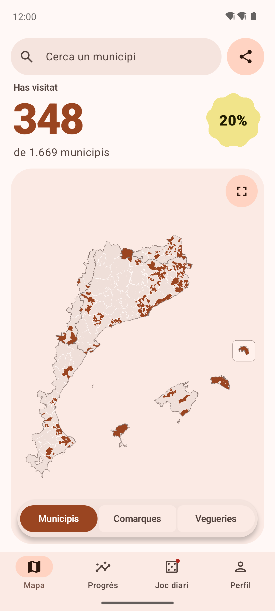
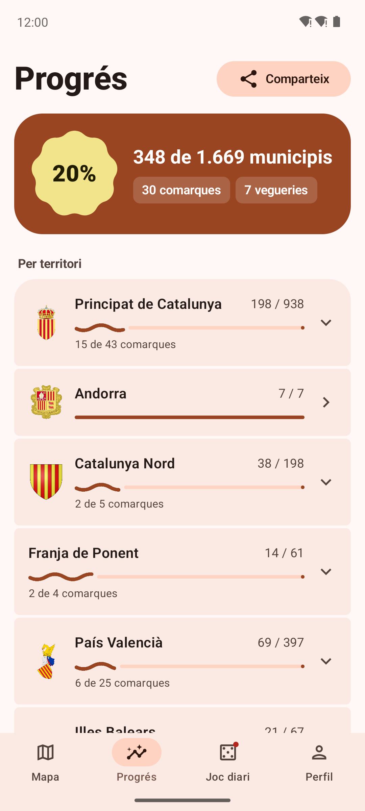
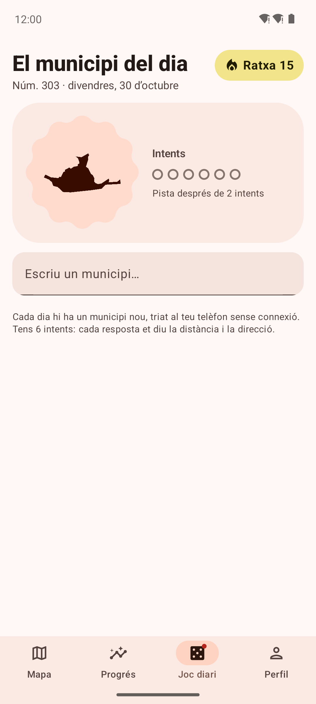
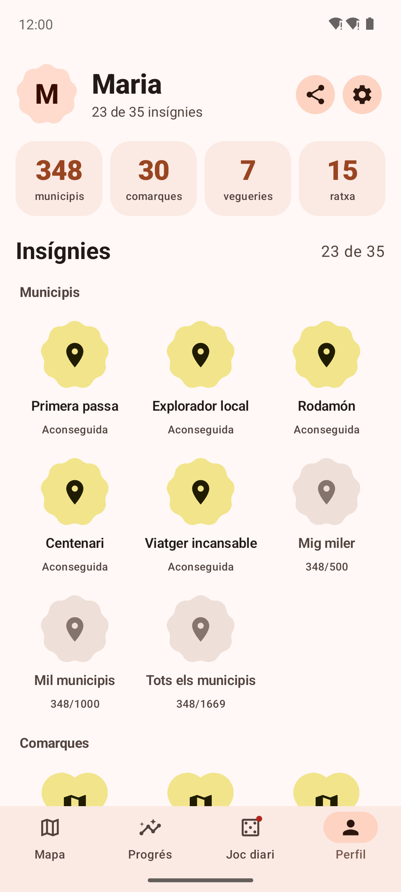
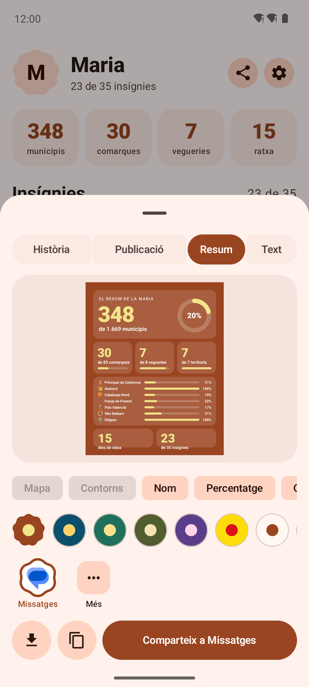

<div align="center">


# Països Catalans

**Porta el compte dels municipis, comarques i vegueries que has visitat.**<br>
Sense connexió, sense comptes i sense que les teves dades surtin del telèfon.

[](https://github.com/lemonade1921/paisos-catalans/releases/latest)


[**Baixa l'APK**](https://github.com/lemonade1921/paisos-catalans/releases/latest)

</div>

<p align="center">
  
  
  
  
  
</p>

## Què hi trobaràs

| | |
|---|---|
| 🗺️ **Mapa** | Municipis, comarques i vegueries en un mapa vectorial que funciona sense connexió. Toca un municipi per marcar-lo com a visitat. Cerca i pantalla completa. |
| 📊 **Progrés** | Percentatge visitat de cada territori i de cada comarca, amb l'escut de cada territori. |
| 🎯 **Joc diari** | Endevina el municipi del dia en sis intents amb pistes de distància i direcció. Mantén la ratxa i, si vols, rep un recordatori. |
| 🏅 **Insígnies** | Per municipis, comarques, vegueries, territoris i ratxes. Cada medalla es pot girar en 3D; les noves arriben amb confeti. |
| 📤 **Comparteix** | Imatge en format història, publicació o **resum amb estadístiques**, amb 8 paletes de colors. Només mostra les apps que tens instal·lades. |
| ⚙️ **Ajustos** | Nom, foto i article personal; aparença clara, fosca o OLED; còpia de seguretat i restauració. |

Inclou el Principat de Catalunya, Andorra, Catalunya Nord, la Franja de Ponent, el País Valencià (municipis de
predomini lingüístic valencià), les Illes Balears i l'Alguer: **1.669 municipis, 83 comarques i 8 vegueries**.
Tota l'app és en català i fa servir Material 3 Expressive.

## Instal·lació

1. Obre la [darrera versió](https://github.com/lemonade1921/paisos-catalans/releases/latest) des del telèfon i baixa
   el fitxer `paisos-catalans-vX.Y.Z.apk`.
2. Obre'l. Si Android t'ho demana, permet instal·lar apps des del navegador o del gestor de fitxers.
3. Per actualitzar, instal·la l'APK nou per sobre: totes les versions es signen amb la mateixa clau i
   les teves dades es mantenen.

Cal Android 10 o posterior.

## Privadesa

- L'app **no té permís d'Internet**. No hi ha comptes, anuncis ni analítiques.
- Els mapes i els escuts van dins de l'APK.
- Les dades es desen només a l'emmagatzematge privat de l'app. La còpia de seguretat és un fitxer JSON que
  guardes on vulguis.
- El municipi del dia es tria al telèfon: tothom té el mateix el mateix dia, sense cap servidor.

## Dades i llicències

- **Límits**: © col·laboradors d'[OpenStreetMap](https://www.openstreetmap.org/copyright), llicència
  [ODbL](https://opendatacommons.org/licenses/odbl/). Es generen amb `tools/build_data.py` a partir dels extractes de
  [Geofabrik](https://download.geofabrik.de/).
- **Escuts**: [Wikimedia Commons](https://commons.wikimedia.org/) via Wikidata (P94), amb `tools/escuts.py`.
  L'autoria i la llicència de cada escut es desen a `app/src/main/assets/escuts/escuts.json`.

## Compilar

Cal JDK 17.

```bash
./gradlew assembleRelease
```

Si no hi ha `app/src/main/assets/geo.json`, genera'l abans (cal `osmium-tool`):

```bash
pip install -r tools/requirements.txt
python tools/build_data.py --cache .cache-osm
python tools/escuts.py
```

A GitHub Actions, cada `push` a `main` compila l'APK. Quan `versionName` (a `app/build.gradle.kts`) canvia, es
publica automàticament la versió `v<versionName>` amb l'APK adjunt i s'actualitzen les captures de pantalla.
Per signar amb una clau pròpia, defineix els secrets `SIGNATURA_FITXER_B64` (el `.jks` en base64),
`SIGNATURA_CONTRASENYA` i `SIGNATURA_ALIES`. Si no hi són, es fa servir la clau de desenvolupament del repositori.
